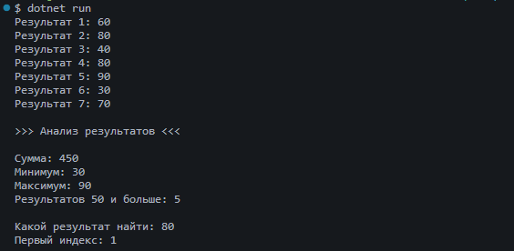

# Практическая работа №17

Автор: Межидов Адам
Группа: ИСП-252

## Тема

Алгоритмы обработки массивов.

## Что реализовано

- сумма элементов;
- подсчёт элементов по условию;
- минимум и максимум;
- линейный поиск;
- поиск первого индекса.

## Короткие ответы

1. Почему максимум нельзя всегда начинать с `0`?

Ответ: Потому что все числа могут быть отрицательными. Тогда 0 окажется больше настоящего максимума, и ответ будет неверным. Начинать надо с первого элемента массива.

2. Что означает `-1` после поиска индекса?

Ответ: Это значит, что значение не найдено. Индексы начинаются с 0, поэтому -1 не может быть настоящим индексом.

3. Чем сумма отличается от подсчёта элементов?

Ответ: Сумма складывает числа. А подсчёт просто считает, сколько их.

## Результат

